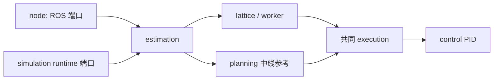

# MVP2.1 模块开发入口

本目录是当前仿真使用的可编辑实现。当前同步到 `mvp2.1` 的 `3652e9b`，另同步
`mpc-car-run` 的 `d155a80` 感知道路配对参数。两个版本的原始 MVP2.1 文件分别保留在
`offline/mvp21_sim/upstream/` 和其 `3652e9b/` 子目录。仿真通过正常Python导入使用本目录，
以后应修改对应模块，不再从单文件动态提取算法。

| 文件 | 负责内容 |
|---|---|
| `contracts.py` | 观测记录、传感器与状态常量、共同传感器准入 |
| `geometry.py` | 坐标/四元数、折线投影与弧长工具 |
| `frenet.py` | 有序参考线的共享 Frenet 坐标图，不生成候选 |
| `candidates.py` | policy 的 Frenet 候选输入契约及新版导出适配 |
| `motion.py` | 轮速/偏航率滤波、运动历史、坐标传播 |
| `estimation.py` | 道路、状态和障碍估计，历史锥桶与道路支持 |
| `planning.py` | 中线路径、原V1兼容规划、参考准入与有效期 |
| `control.py` | PID、控制参考管理、距离限制与标定记录 |
| `execution.py` | 唯一执行管理器：锚点对齐、弧长裁剪、滚动检查、任务隔离、共同 PID 计算与回退 |
| `lattice.py` | ShadowSettings、道路时序融合、候选生成、边界碰撞和评分选择 |
| `transport.py` | 20 Hz 道路历史采集、纯规划任务提交、最新任务队列和后台子进程 |
| `worker.py` | 无ROS的逐行JSON规划协议 |
| `node.py` | ROS输入输出、状态机、主循环与学生插入代码 |
| `api.py` | 仿真兼容导出面；新代码优先直接导入所属模块 |
| `provenance.py` | 实际模块源码指纹 |

算法模块不导入ROS，也不会在导入时创建线程或进程。跨模块继续使用原来的字典
数据结构、字段、坐标系、单位和有效期。`node.py`独占ROS消息转换与生命周期，
`ShadowWorker`显式启动时才创建后台执行。ROS 与仿真使用同一 `execution.py`；
原本地 `reference.py` 及其独立执行入口已删除。共同 YAML 选择 planner，保留上游回退。
默认检查/评分范围与 1.0 m 长度沿用实车 MVP2.1，全长检查、全长评分和 1.3 m 仅显式实验使用。
接线与结果见[统一执行说明](../offline/mvp21_sim/SHARED_EXECUTION_CN.md)。



按用户要求，旧 V2 planner 已移除，两个 script 名称均进入同一套 MVP2.1 模块；
`config/ai4r_policy.yaml` 为 ROS/仿真共同参数源，`planner_control.enabled: true`。
旧模型/数据和上游来源快照保留。
训练通过[三组输入协议](../offline/lattice_training/POLICY_INPUT.md)读取当前状态、道路/障碍和候选轨迹，
不读取 native 评分或上一条路径；旧模型/候选兼容代码已删除。
学习评分尚未启用；本次没有部署。节点停止发布与`INSERT POLICY CODE`标记保持。

## 仿真与打包

从仓库根目录使用现有虚拟环境，输出目录必须不存在：

```powershell
../Baby-Bus/.verification/planner-sim-venv/Scripts/python.exe -B -m offline.mvp21_sim --path-source perception --output .verification/modular-centerline-new
../Baby-Bus/.verification/planner-sim-venv/Scripts/python.exe -B -m offline.mvp21_sim --path-source lattice --output .verification/modular-one-hz-new
../Baby-Bus/.verification/planner-sim-venv/Scripts/python.exe -B tools/bundle_python.py scripts/mvp21_policy_node.py --root . --output build/mvp21_policy_single.py
```

单文件工具来自`feature/python-single-file-bundler`的`66eaea923a7b040de4908975ffecda118795f393`，
原样带入脚本、说明和17项测试。它保留模块层级并恢复到临时目录，支持worker子进程；
不是把算法拼接到一个共享全局命名空间。ROS及其他外部依赖仍由运行环境提供。
完整参数与可选profiling见[打包说明](../tools/BUNDLE_PYTHON.md)。生成文件位于
忽略的`build/`，每次由模块重新构建，不作为另一份算法源码维护。

仿真日志同时保存上游原文件指纹和`runtime_modules`实际源码指纹。worker返回的
`source_sha256`现按`source_sha256_format=mvp21_worker_geometry_lattice_v2`计算，覆盖
`worker.py`、`geometry.py`、`frenet.py`、`lattice.py`，不把原单文件的hash当作模块运行版本。
任务generation/job_id、shadow_only、结果状态与计时字段保持。

## 本次验证

以下为模块拆分完成时的历史记录。后续旧 V2 退役与 policy 接口迁移改变了授权范围内的
源码/配置；当前检查与模型保护范围见[接口说明](../offline/lattice_training/POLICY_INPUT.md)。

以下为初始模块迁移证据。后续1 Hz修改的23项检查、延迟闭环和参数范围单独记录于
[1 Hz闭环实验](../offline/mvp21_sim/ONE_HZ_CONTROL.md)。

机械迁移审计确认50个纯算法定义的AST完全一致；ROS主函数、任务提交方法保持，
节点只增加共享提交方法的继承并修改两处worker入口构造。后台队列逻辑保持，
worker中正常导入替代了原来的AST提取。

两组全程回放逐帧比对通过：中线组152帧、lattice组151帧的动作、参考路径、
控制诊断、估计状态、位姿、进度与车角余量完全一致，所有候选和选择结果也一致
（不比较实际耗时）。74个原训练/配置/环境文件指纹保持。

```powershell
../Baby-Bus/.verification/planner-sim-venv/Scripts/python.exe -B tests/test_mvp21_modules.py -v
../Baby-Bus/.verification/planner-sim-venv/Scripts/python.exe -B tests/test_mvp21_sim.py -v
../Baby-Bus/.verification/planner-sim-venv/Scripts/python.exe -B tests/test_bundle_python.py -v
```

4项模块/进程检查、8项仿真检查、17项打包检查通过，共29项。其中模块检查覆盖
无ROS/无后台副作用导入、实际JSON子进程、安装目录布局、仓库外单文件运行及
单文件内再次启动子进程。迁移审计是一次性证据，不作为禁止后续调参的冻结测试。
ROS fast gate已尝试，构建前因缺少固定dream_interfaces checkout而停止，完整ROS
安装与硬件均未验证。

精简证据见[modularization.json](../offline/mvp21_sim/artifacts/2026-10-15/modularization.json)，
完整审计与两组回放位于`.verification/mvp21-modularize-20261015/`。

当前分支同步范围、两种执行适配的区别和验证见
[2026-10-16 模块同步记录](../offline/mvp21_sim/UPSTREAM_SYNC_20261016.md)。

2026-10-17 单侧输出修复：ordered_xy 的观测边界不再因宽度未知而丢失。
成功的状态/运动对齐后，现有 forward_geometry 可携带单侧 observed 边界；
完整道路 valid 与 near_field.valid 仍为 false，不补中线、对侧或真实宽度。
仅在当前仿真分支验证，未合并或部署主线；无宽度先验掉头的完整尝试和剩余失败见
[对照报告](../offline/lattice_training/artifacts/2026-10-17-single-boundary-fix/REPORT_CN.md)。

2026-10-17 单边无宽度参考调整：`shadow.unknown_width_reference_scale=4/3` 只在
没有中线、只有一侧边界且宽度未知时，将 CG 参考偏移从 0.45 m 增为 0.60 m；
`search_half_width_m` 保持 0.45 m，已知宽度仍采用既有半宽规则，不新增对侧边界、
车身 guard 或 policy 输入特征。固定验证道路及运行入口见
[固定掉头验证说明](../offline/lattice_training/validation_roads/README.md)。
