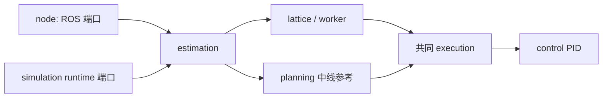

# MVP2.1 模块开发入口

本目录是当前仿真使用的可编辑实现。当前同步到 `mvp2.1` 的 `3652e9b`，另同步
`mpc-car-run` 的 `d155a80` 感知道路配对参数。两个版本的原始 MVP2.1 文件分别保留在
`offline/mvp21_sim/upstream/` 和其 `3652e9b/` 子目录。仿真通过正常Python导入使用本目录，
以后应修改对应模块，不再从单文件动态提取算法。

| 文件 | 负责内容 |
|---|---|
| `contracts.py` | 观测记录、传感器与状态常量、共同传感器准入 |
| `geometry.py` | 坐标/四元数、折线投影与弧长工具 |
| `frenet.py` | 有序参考线的共享 Frenet 坐标图，不生成候选 |
| `candidates.py` | policy 的 Frenet 候选输入契约及新版导出适配 |
| `motion.py` | 轮速/偏航率滤波、运动历史、坐标传播 |
| `estimation.py` | 道路、状态和障碍估计，历史锥桶与道路支持 |
| `planning.py` | 中线路径、原V1兼容规划、参考准入与有效期 |
| `control.py` | PID、控制参考管理、距离限制与标定记录 |
| `execution.py` | 唯一执行管理器：锚点对齐、弧长裁剪、滚动检查、任务隔离、共同 PID 计算与回退 |
| `lattice.py` | ShadowSettings、道路时序融合、候选生成、边界碰撞和评分选择 |
| `learned.py` | 冻结 RNN 加载、候选评分和实际执行状态提交 |
| `models/path_policy.json` | 不改写的最新多起点 RNN 权重，嵌入单文件 |
| `transport.py` | 20 Hz 道路历史采集、纯规划任务提交、最新任务队列和后台子进程 |
| `worker.py` | 无ROS的逐行JSON规划协议 |
| `node.py` | ROS输入输出、状态机、主循环与学生插入代码 |
| `api.py` | 仿真兼容导出面；新代码优先直接导入所属模块 |
| `provenance.py` | 实际模块源码指纹 |

算法模块不导入ROS，也不会在导入时创建线程或进程。跨模块继续使用原来的字典
数据结构、字段、坐标系、单位和有效期。`node.py`独占ROS消息转换与生命周期，
`ShadowWorker`显式启动时才创建后台执行。ROS 与仿真使用同一 `execution.py`；
原本地 `reference.py` 及其独立执行入口已删除。共同 YAML 选择 planner，保留上游回退。
默认检查/评分范围与 1.0 m 长度沿用实车 MVP2.1，全长检查、全长评分和 1.3 m 仅显式实验使用。
接线与结果见[统一执行说明](../offline/mvp21_sim/SHARED_EXECUTION_CN.md)。



按用户要求，旧 V2 planner 已移除，两个 script 名称均进入同一套 MVP2.1 模块；
`config/ai4r_policy.yaml` 为 ROS/仿真共同参数源，`planner_control.enabled: true`。
旧模型/数据和上游来源快照保留。
训练通过[三组输入协议](../offline/lattice_training/POLICY_INPUT.md)读取当前状态、道路/障碍和候选轨迹，
不读取 native 评分或上一条路径；旧模型/候选兼容代码已删除。
2026-10-21 按用户选择启用最新多起点 RNN；当前部署目标已改为 `10.43.254.19`。
节点停止发布与`INSERT POLICY CODE`标记保持。

`learned.py` 复用 `offline/lattice_training/` 中的纯推理编码与网络函数，不加载训练器、
数据集或 C*。仅对通过原生碰撞准入的候选逐条评分，不读取 native 代价。
一次决策的所有候选共享同一前序隐藏状态；只有已准入 lattice 路径的 PID 动作成功发布后，
才提交该候选的下一状态，同一任务只提交一次。中线回退、拒绝和过期任务不提交；
状态机切换清空记忆。基于旧记忆的异步结果在进入执行管理器前被拒绝。
模型失败明确标为 `POLICY_ERROR`，通过共同执行管理器处理回退，不冒充学习选路成功。
当前原生候选数为 48，训练时为 8；匹配 0.5 m/s 目标不代表实车执行等同 C*，
既有感知、分支和掉头限制仍见[限制记录](../docs/SIMULATION_LIMITATIONS_CN.md)。

## 仿真与打包

共同 YAML 的 `estimation.colour_assignment: auto` 同时检查两种左右颜色映射，
只从新鲜且可独立配对的双侧观测确认；不以单个桶的 y 正负、已知宽度或历史预测确认。
若两个映射都成立，选择距车更近的有效中线路径，但距离差必须超过一个采样间距；
否则保持未确认。确认后本次 Run 固定该映射，部分输出、弯道或历史清空不触发翻转。
下一次显式 Stop/Run 新建估计器并重新判断。未确认时，在既有 1 s 启动窗口内持续零输出，
超时或运行中的故障仍停止并要求手动恢复。日志 `Boundary colour assignment:` 给出实际
选择及两个解释的诊断；规划拒绝日志也记录这些信息。宽度、方向和连续覆盖准入保持。
`left_colour/right_colour` 仅供历史或显式 `fixed` 模式使用，当前自动模式忽略这两个值。

缺角速度时，ROS 节点可通过 `control.gyro_fallback_enabled` 进入相机循迹降级；
共同 YAML 在 `.22` 按用户要求恢复严格 IMU 模式后已关闭此选项，裸节点也默认关闭。
仅适用于 `mvp` + `road_centerline`。显式启用后，冷启动
缺少 gyro，或运行中 gyro 超过运动估计的有效期限时，节点记录 `Gyro fallback:`
告警并发布状态原因，改用最新单帧双侧锥桶拟合的路径和现有 PID。目标速度上限
为 `control.gyro_fallback_speed_mps`（0.2 m/s），相机采集年龄上限为
`control.gyro_fallback_max_camera_age_s`（0.35 s）；轮速仍须有效。

该模式保留真实采集时间和 `time_aligned: false`，不把缺失角速度填成零，
不做相机延迟补偿、不沿用历史道路或学习宽度、不提交或执行 native 异步规划。
运行中切换会清空旧参考并隔离已有任务；计算期间发生切换时，该次旧动作被丢弃并
发布零动作。空帧、单侧道路、过期相机、轮速或其他必需传感器失效仍进入持续零动作
状态，需要手动 Run。IMU 恢复后也保持降级，下一次手动 Stop/Run 才重新选择正常
模式。缺少运动补偿会降低弯道及相机延迟下的循迹精度；这些检查不代表实车效果。

部署本次单文件时还须同步共同 YAML 中新增的参数；bundle 内的配置快照不自动加载。
`.22` 最新起步调整将驱动前馈从 0.40 提高到 0.50、驱动上限从 0.45 提高到 0.50；
此次接入 RNN 后目标速度按用户选择改为 0.5 m/s，与训练条件一致。
驱动参数是归一化驱动调参值，不是实测起步阈值；停止和必需传感器
故障仍立即输出零。重启节点后须重新手动 Run，不自动恢复动作。

从仓库根目录使用现有虚拟环境，输出目录必须不存在：

```powershell
../Baby-Bus/.verification/planner-sim-venv/Scripts/python.exe -B -m offline.mvp21_sim --path-source perception --output .verification/modular-centerline-new
../Baby-Bus/.verification/planner-sim-venv/Scripts/python.exe -B -m offline.mvp21_sim --path-source lattice --output .verification/modular-one-hz-new
python -B tools/bundle_python.py scripts/mvp21_policy_node.py --root . --output scripts/policy_node.py --no-auto-resources --resource config/ai4r_policy.yaml --resource mvp21_policy/models/path_policy.json
```

单文件工具来自`feature/python-single-file-bundler`的`66eaea923a7b040de4908975ffecda118795f393`，
原样带入脚本、说明和17项测试。它保留模块层级并恢复到临时目录，支持worker子进程；
不是把算法拼接到一个共享全局命名空间。ROS及其他外部依赖仍由运行环境提供。
完整参数与可选profiling见[打包说明](../tools/BUNDLE_PYTHON.md)。按用户要求，
交付文件固定为环境接受的 `scripts/policy_node.py`；每次从模块重新
生成，不直接维护其中的算法副本。当前文件包含 21 个源码文件、共同 YAML
快照与冻结模型。除原有 ROS 依赖外，推理需要 NumPy（目标车已确认 1.26.4）。
模型已嵌入脚本，无须另传权重文件。YAML 快照用于留存配置，不自动替代 ROS 的
参数加载；运行仍沿用现有 launch/`--ros-args --params-file` 配置方式，并需要目标环境
提供 ROS 2 Jazzy 与对应消息包。上述构建入口及 `mvp21_policy/` 目录无需随单文件复制。
当前单文件验证及完整 ROS gate 的限制见[验收记录](../docs/acceptance.md)。

同日从 `feature/mpc-model@15724bc` 选取合入 planner 的二分弧长查找和每次规划内的
采样帧缓存，再生成上述单文件。候选、评分、当前 PID 执行与 YAML 保持原语义；
这两项优化未引入 MPC 控制器；学习评分在随后本次接入中单独启用。

仿真日志同时保存上游原文件指纹和`runtime_modules`实际源码指纹。worker返回的
`source_sha256`现按`source_sha256_format=mvp21_worker_policy_lattice_v3`计算，覆盖
`worker.py`、`geometry.py`、`frenet.py`、`lattice.py`、`candidates.py`、`learned.py`。
学习诊断另记录 `inference_source_sha256` 和模型校验值，不把原单文件的 hash 当作模块运行版本。
任务generation/job_id、shadow_only、结果状态与计时字段保持。

## 本次验证

以下为模块拆分完成时的历史记录。后续旧 V2 退役与 policy 接口迁移改变了授权范围内的
源码/配置；当前检查与模型保护范围见[接口说明](../offline/lattice_training/POLICY_INPUT.md)。

以下为初始模块迁移证据。后续1 Hz修改的23项检查、延迟闭环和参数范围单独记录于
[1 Hz闭环实验](../offline/mvp21_sim/ONE_HZ_CONTROL.md)。

机械迁移审计确认50个纯算法定义的AST完全一致；ROS主函数、任务提交方法保持，
节点只增加共享提交方法的继承并修改两处worker入口构造。后台队列逻辑保持，
worker中正常导入替代了原来的AST提取。

两组全程回放逐帧比对通过：中线组152帧、lattice组151帧的动作、参考路径、
控制诊断、估计状态、位姿、进度与车角余量完全一致，所有候选和选择结果也一致
（不比较实际耗时）。74个原训练/配置/环境文件指纹保持。

```powershell
../Baby-Bus/.verification/planner-sim-venv/Scripts/python.exe -B tests/test_mvp21_modules.py -v
../Baby-Bus/.verification/planner-sim-venv/Scripts/python.exe -B tests/test_mvp21_sim.py -v
../Baby-Bus/.verification/planner-sim-venv/Scripts/python.exe -B tests/test_bundle_python.py -v
```

4项模块/进程检查、8项仿真检查、17项打包检查通过，共29项。其中模块检查覆盖
无ROS/无后台副作用导入、实际JSON子进程、安装目录布局、仓库外单文件运行及
单文件内再次启动子进程。迁移审计是一次性证据，不作为禁止后续调参的冻结测试。
ROS fast gate已尝试，构建前因缺少固定dream_interfaces checkout而停止，完整ROS
安装与硬件均未验证。

精简证据见[modularization.json](../offline/mvp21_sim/artifacts/2026-10-15/modularization.json)，
完整审计与两组回放位于`.verification/mvp21-modularize-20261015/`。

当前分支同步范围、两种执行适配的区别和验证见
[2026-10-16 模块同步记录](../offline/mvp21_sim/UPSTREAM_SYNC_20261016.md)。

2026-10-17 单侧输出修复：ordered_xy 的观测边界不再因宽度未知而丢失。
成功的状态/运动对齐后，现有 forward_geometry 可携带单侧 observed 边界；
完整道路 valid 与 near_field.valid 仍为 false，不补中线、对侧或真实宽度。
仅在当前仿真分支验证，未合并或部署主线；无宽度先验掉头的完整尝试和剩余失败见
[对照报告](../offline/lattice_training/artifacts/2026-10-17-single-boundary-fix/REPORT_CN.md)。

2026-10-17 单边无宽度参考调整：`shadow.unknown_width_reference_scale=4/3` 只在
没有中线、只有一侧边界且宽度未知时，将 CG 参考偏移从 0.45 m 增为 0.60 m；
`search_half_width_m` 保持 0.45 m，已知宽度仍采用既有半宽规则，不新增对侧边界、
车身 guard 或 policy 输入特征。固定验证道路及运行入口见
[固定掉头验证说明](../offline/lattice_training/validation_roads/README.md)。
