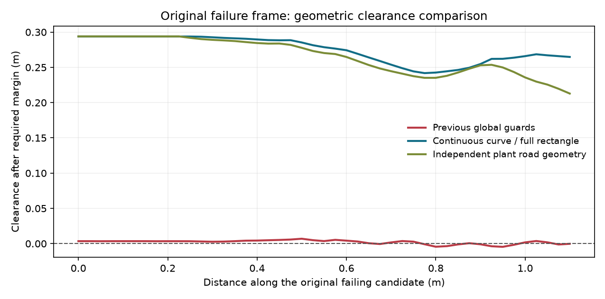

# 连续边界与完整车身净空检查

后续的[入弯失败与离线计时复核](REMAINING_DIAGNOSIS_CN.md)说明1.939 m的坐标含义、
低速检查的实际触发条件、仿真与真实计算时钟的区别，以及恢复后继续失败的状态。

2026-10-15，接续 [改动前诊断](NATIVE_REPLAY_CN.md)。用户授权替换基于离散车身点
及额外保护量的净空计算。改动集中在 `scripts/policy_node.py` 的 `LatticeCurve`
和 `FrenetLatticePlanner`；不改变感知接口、道路重建、车辆模型、C*控制器或训练模型。

## 当前几何定义

车身是随候选姿态旋转和平移的完整实心矩形，宽0.25 m，CG前后伸0.297/0.198 m。
对现有分段三次连续边界，先检查车身内外关系和完整支持，再计算边界曲线到矩形的
最小欧氏距离。车身完全在道路外或边界穿入车身均拒绝。这个计算不再使用10个边缘
采样点，不再使用全局最大斜率换算距离，也不从距离中扣除 `edge_guard`。

计算把每段三次曲线变换到车身坐标系，在曲线跨过矩形四条支撑线的位置分区。
每区间的距离平方是至多六次多项式，求端点及其导数根；直线段使用线段到矩形的
直接解。包围盒和投影只用于排除不可能更近的曲线段，不改变接受阈值。

道路安全余量仍为0.05 m。只有在显式受控起步的未观测后向延拓区，继续保留原有
0.08 m/m不确定性余量；在完整观测支持上它为零。雷达点障碍仍按原0.05 m障碍
余量加0.05 m硬余量检查，当前锥桶道路实验关闭该障碍输入。

## 相邻姿态与运行预算

移除 `sweep_guard` 后，连续边界检查不会自动覆盖轨迹采样姿态之间的运动。
实现按当前Frenet多项式和参考曲线导数界，计算区间内任意车身点的最大移动速度界。
若两端的道路/障碍净空与支持范围可覆盖这段运动，则确认该区间；否则检查真实中间
姿态并继续二分。每个原始姿态区间最多128次细分，参考弧长区间小于1e-8 m仍无法
确认时以 `continuous_body_check_unresolved` 拒绝。界用于决定检查细分，不从几何
净空中扣除。多项式求根使用有限次数浮点迭代，不是形式化安全证明。
保留的Cartesian兼容输出也对拟合多项式做同类区间检查；本次道路实验继续关闭该
兼容拟合，直接消费Frenet参考。

planner的35 ms配置、来源时效、参考有效期和20 Hz仿真调用间隔保留。
搜索窗口同时受实际剩余来源/参考有效期约束；已有可行候选时，根据已观测候选耗时
提前结束进一步搜索，为输出检查留时间。未通过的候选、超时和未解决的几何区间
继续显式失败，不复用旧路径掩盖失败。

## 验证范围

新增检查覆盖：精确直线距离、网格参数不影响单姿态净空、过窄位置和真实侵入位于
原采样点之间、旋转车身、斜边界最近角点、全车身越界、支持域不足、曲线与矩形
距离对独立密集采样的对照、Frenet车身运动界对独立数值位移的对照，以及两端姿态
安全但中间发生道路/障碍碰撞的情形。

改动前的三个固定失败状态，保持相同2 m理想地图输入和精确plant状态，原采样参数
现均能产生有效的非STOP Frenet路径，协议检查零错误。35 ms预算复核三次观测耗时
为19.4/21.1/23.6 ms，仅说明这些查询通过，不构成整个系统实时资格。

旧失败候选90个几何样本的最小计算余量，从原方法的−0.004544 m变为直接连续几何
检查的0.241844 m。独立plant使用不同的分段道路几何，其对应最小余量0.212866 m；
两者不是相同的边界表达式，数值不应强行一致。

原默认采样、零速起步、相同C*闭环（几何隔离wall budget）产生281帧有效路径后于
1.815711 m失败，终点仍为4.736800 m，未宣称完成道路。其它对照和最终检查结果
保存在本记录对应的精简证据文件中。

| 完整闭环尝试 | 有效路径帧 | 最后站点 | 结束原因 |
|---|---:|---:|---|
| 原默认采样，隔离wall budget | 281 | 1.815711 m | 无可行候选，含转角/转角速率与支持范围拒绝 |
| 前次纯参数组，隔离wall budget | 359 | 1.939313 m | `low_speed_yaw_inconsistent` |
| 原默认采样，35 ms预算 | 4 | 0.407708 m | `lattice_time_budget_exceeded` |
| 0.8 m规划范围、0.05 m初始网格，35 ms预算 | 159 | 1.019469 m | `lattice_time_budget_exceeded` |

第二项失败时plant纵向速度0.049881 m/s、偏航率−0.060220 rad/s，触发现有低速
初始化假设；本轮未改变该阈值。第四项仍固定2 m地图输入，只调整planner范围、
采样长度和网格；配置保留在证据中，未写入生产默认值。其全部查询最大耗时
36.818 ms，不能记为35 ms预算或完整20 Hz回放已通过。C*耗时仍不计入仿真时钟。

当前planner回归42项（原34项加8项几何/区间检查）、训练/集成管线53项、估计53项、
旧规划18项和控制21项全部通过，共187项。最终完整训练/集成套件耗时624.207 s。
另外100组随机曲线与旋转车身均通过独立4001点密集距离对照。各次实验与检查的指纹见
[精简验证记录](artifacts/2026-10-15-continuous-body/verification.json)。



完整日志在 `.verification/native-log-road-20261014/continuous-body/`，其它回归日志
以 `.verification/native-log-road-20261014/continuous-` 开头。ROS gate需要已固定的
`dream_interfaces` checkout；缺失该依赖时仅报告实际阻塞，不安装或更换ROS依赖。

从本工作树根目录复现默认预算重放：

```powershell
../Baby-Bus/.verification/planner-sim-venv/Scripts/python.exe -B -m offline.lattice_training.native_replay --road .verification/native-log-road-20261014/reconstruction-end1/road.json --config offline/lattice_training/native_recorded_road.json --output .verification/native-log-road-20261014/reproduce-continuous-body
```

未到终点时命令返回非零退出状态。历史文件中的 `native_global` 是旧配置标签；
各次源文件指纹识别实际实现，新runner另记录 `continuous_geometry`、
`continuous_cubic_to_oriented_rectangle` 与 `bounded_adaptive_pose_intervals`。
