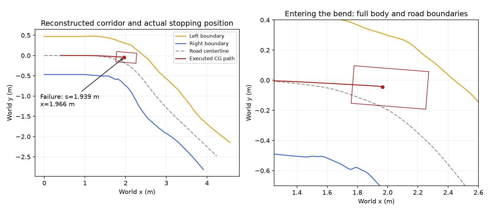

# 入弯失败与离线计时复核

2026-10-15，接续[连续边界修改记录](CONTINUOUS_BODY_CN.md)。本轮没有改变 native
planner 源码、低速阈值、35 ms 默认预算或车辆/安全限制。以下反事实仅在单独诊断
进程内替换指定方法，不能算生产 planner 通过，也不算20 Hz实时通过。

## 位置含义

原参数组失败的1.939313 m是plant提供的道路中心线进度`s`，不是世界坐标`x`。
同一帧`x=1.965656 m, y=-0.044237 m`；相对起点`s=0.407531 m`只前进
1.531782 m。道路目标为`s=4.736800 m`，失败处只是进入弯道。
重建plant前1 m为显式未观测入口延拓，不能把这一段算作实测道路覆盖。



## 低速检查在检查什么

每一次`FrenetLatticePlanner.plan()`都需要从当前运动状态确定新路径的起始条件，
包括起始位置、方向和曲率。当前实现使用如下分支：

```python
initial_k = yaw / speed if speed >= 0.05 else 0.0
if speed < 0.05 and abs(yaw) > 0.05:
    raise ValueError("low_speed_yaw_inconsistent")
```

这里`speed`单位是m/s，`yaw`实际是偏航角速度，单位rad/s。
`yaw/speed`是对起始曲率的近似。低速分支是为了避免接近零速时直接相除；它并非
只在起步执行，也不是由车身净空或道路宽度推导的物理可行性检查。

失败帧的纵向速度为0.04988097 m/s，偏航率为−0.06021959 rad/s，因而直接触发
该分支，尚未开始评估候选路径。实际前轮转角−0.37912444 rad（约−21.7°），小于
45°上限。按当前低速自行车模型，`vx*tan(delta)/0.33`给出的偏航率为
−0.06021960 rad/s，与plant吻合。这是模型允许的低速转弯，不能称为物理异常。

保持相同道路和转弯比例，速度0.0499 m/s被拒绝，0.0500 m/s即可生成非STOP路径。
原失败帧在只将有限速度曲率分支下限改为1e-6 m/s的进程内对照中也可生成路径，
协议检查通过。这说明该硬阈值存在不连续拒绝；不意味着1e-6应成为实车阈值。

另须区分速度定义：仿真轮速代理和当前`plant_truth`输入使用`abs(vx)`；
C*评价使用CG平面速度`hypot(vx,vy)`及其运动方向。此帧平面速度0.05051037 m/s，
运动方向相对车头为−0.15803030 rad，约−9.1°。只替换为平面速度也能跨过该阈值，
但这会改变输入约定，不能作为已确认的修复。

## 为什么仿真也会超时

仿真每步推进0.05 s，与执行Python程序的真实耗时是两个时钟。
`native_replay.make_native()`在计时实验中给planner注入`time.perf_counter`；
planner将它测出的真实经过时间与`LatticeSettings.budget_s=0.035`比较。
因此虚拟车辆没有推进下一步时，一次计算也可能已经在电脑上花费超过35 ms。

35 ms是当前代码的配置限制；20 Hz是日志中确认的策略频率，对应50 ms调用间隔。
不能把35 ms另称为已找到的MVP 2.0协议要求，也不能由一次主机超时推断车上CPU
必然超时。该离线管线中C*求解的真实耗时另计，不推进仿真时钟。

原短范围计时实验于`s=1.019469 m`失败，planner内部测得36.727 ms，外层调用
36.818 ms。同一固定输入单独重跑8次，全部通过35 ms门槛，耗时25.778–27.422 ms。
因此那次超时不是该道路状态稳定必现的几何失败；原实验也与训练测试并行运行，
没有足够证据将超时唯一归因于某个系统负载因素。

冻结planner时钟会同时取消搜索的按时截断，因而通常评估更多候选；同输入完整
搜索的耗时不能直接拿来与提前返回的计时查询比较。性能剖析仅用于定位热点：
该帧完整搜索的主要耗时在连续边界到矩形车身的距离求解和多项式求根，约占被
剖析planner时间的84%。剖析工具会增加耗时，其绝对时间不作为实时验收结果。

几何排查使用冻结时钟，主机性能测试保留真实时钟。前者不证明满足20 Hz，后者
需要在功能正确后以固定输入、独立负载和目标硬件另行验证。

## 继续驶入弯道后的问题

重放原359帧控制动作后，7维plant状态与原失败状态完全一致，最大绝对差为零。
只在诊断进程允许有限速度使用曲率比值，并恢复上一帧路径作为一致性提示。
恢复段在首帧重新运行C*，随后仍按原0.5 s控制重规划间隔执行；它不是原运行的
无缝成功续跑。恢复后再产生3帧有效路径，在`s=1.946864 m`再次失败，目标仍为
4.736800 m。这次是短过渡超过转角限制、长过渡碰到连续道路边界，而非计时失败。

在这个新固定状态，保持全部物理和安全阈值，测试0.4/0.6/0.8/1.0/1.2 m规划
范围、0.3–1.2 m过渡长度及−0.25至0.25 m的五个偏移采样，均未找到可行候选。
另外只在诊断进程取消“过渡必须完整位于输出范围内”的限制，测试0.3–0.8 m
输出范围及0.5–1.5 m过渡长度，也未解决该帧。不能再把允许过渡前段说成充分修复。

还将此前在`s=1.019469 m`计时中止的短范围参数组，仅隔离真实时钟，从原起点
重新运行，未改变任何低速分支。产生312帧有效路径后，在`s=1.946846 m`失败，
此帧纵向速度0.152323 m/s，既没有触发低速门槛，也没有发生预算中止。剩余候选中
0.6/0.8 m、保持当前偏移的几何路径可行，但运动剖面超转角速率限制；终止到中心线
的候选超转角上限，STOP候选出现正加速度而被拒绝。该实验耗时176.210 s，仅为
15.6 s仿真，不能算实时通过。这个独立的原生对照进一步确认入弯处问题尚未解决。

将车放回道路中心线并对齐方向，在0.5/1.0/1.5/2.0/2.5/3.0/3.5/4.0/4.5 m九个
位置抽查，原生planner均可输出有效路径。这只说明这些独立状态可规划，不能代替
闭环整路验证。闭环到达状态与初始方向/曲率、C*的CG运动定义及候选表达之间的
衔接仍需排查，尚不能将后续失败唯一归因于其中一项。

数值和源文件指纹见[本轮精简记录](artifacts/2026-10-15-continuous-body/remaining-diagnosis.json)。
完整诊断在`.verification/native-log-road-20261014/remaining-diagnosis/`。
