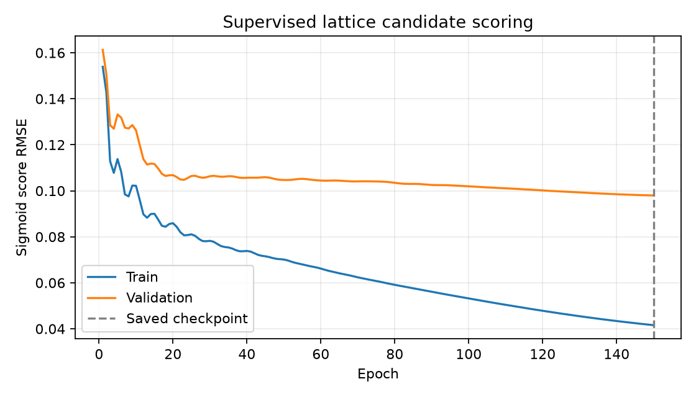
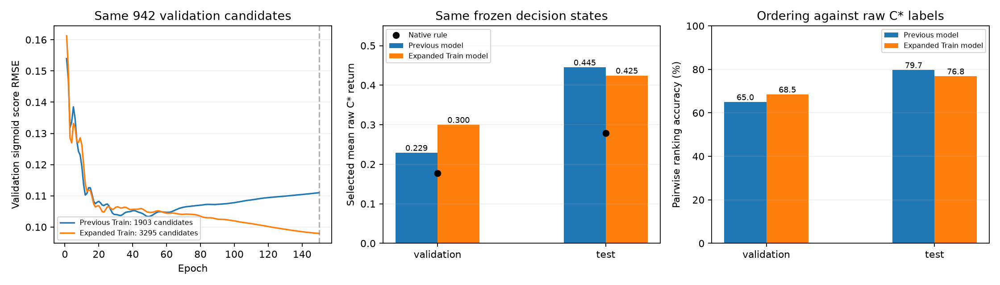

# 扩充 Train 后的 sigmoid policy 训练

日期：2026-10-11；feature/lattice-training-pipeline。

## 实际配置

从头使用与上一轮相同初始化（seed 0）训练：140→32 tanh→1 sigmoid，Adam/.005，150 epochs，pair weight=.25，L2=.0001。
Train 3295 候选/145 决策状态/11 有标签道路；Validation 942/37/2；Test 699/35/2。
先平均原始 C* trial 回报，再计算 sigmoid(R/T)，T=1；所有标签和原始失败惩罚保持。
输入归一化只用扩充 Train；按 Validation score RMSE 保存 checkpoint。Test 不参与梯度、模型选择或参数调整。
保存第 150 轮；包含训练、曲线和标签评价的命令耗时 1.94s。

## 在相同标签上的模型对照

上一轮模型重新预测同一个合并数据集。Validation/Test 与上一轮逐项完全相同；Train 列均用扩充后的 3295 行计算，不能直接拿新 Train 指标与旧 1903 行的历史 Train 指标比较。

| 分区 | 旧/新评分 RMSE | 旧/新原始选路平均回报 | 规则 / Oracle | 旧/新两两排序准确率 |
|---|---:|---:|---:|---:|
| train | 0.080308 / 0.041580 | -3447.877674 / 0.428929 | 0.232387 / 0.465925 | 75.02% / 80.30% |
| validation | 0.103350 / 0.097947 | 0.229130 / 0.299922 | 0.177319 / 0.401119 | 64.99% / 68.49% |
| test | 0.074287 / 0.059393 | 0.445127 / 0.424509 | 0.279209 / 0.484249 | 79.72% / 76.84% |

Validation 的评分误差、选路回报和排序改善。Test 的评分 RMSE 改善，但最高分选路平均回报与两两排序准确率略降，不能宣称全面提升；两个模型均保留。
评分校准误差和 argmax 选路效果是不同指标，应同时查看。Test 只有两条道路/35 个相关决策点；已有标签评价不代表未观测道路或整路闭环表现。
最佳 Validation 在第150轮（本轮预算最后一轮）；本轮没有改变预算或根据 Test 调整训练。





## 训练门槛与保护

训练按有效候选标签/Train 与 Validation 可用性正常启动，没有使用覆盖例外。原 metadata 的历史 training_eligible=false 保留；模型同时记录该历史标记与 training_readiness.eligible=true。
seed8 无候选和零 road goal 继续记为覆盖诊断，不否定已标注路径；没有重新采集或重算标签。
模型加载/source/schema/目标语义、有限0–1分数、Train-only归一化、保存模型与报告指标一致性已核对。
原冻结数据、两轮旧模型、全部 Validation/Test 数组、205 个职责外文件及 Git refs 保持。没有运行单元测试或新 policy 整路闭环。

## 复现

```powershell
python -B -u -m offline.lattice_training train --dataset .verification/train-augmentation-20261011/dataset --output .verification/augmented-sigmoid-training-20261011 --epochs 150 --hidden 32 --seed 0 --learning-rate 0.005
```

已有输出会拒绝覆盖，重跑请使用新输出目录。
模型：model.json；记录：model.training.json；标签评价：evaluation.json；对照：comparison.json；保护和加载检查：verification.json。
