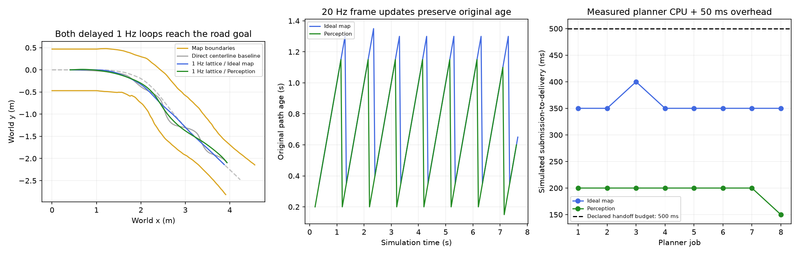

# 1 Hz lattice 规划、20 Hz 控制

> 历史实验，描述统一合并前的本地缓存方案。其独立执行代码现已删除；
> 当前命令、共同执行逻辑及验收结果见 [SHARED_EXECUTION_CN.md](SHARED_EXECUTION_CN.md)。

本轮在模块实现上跑通了重建道路的1 Hz闭环。每秒提交一次规划，20 Hz控制使用
运动对齐后的缓存路径；计算和交付期间车辆继续运动。感知道路与理想道路均到达
既定目标，无规划、控制或plant车角越界拒绝。启动等待首条结果期间保持零动作。

离线入口现在默认使用 `--path-source lattice --lattice-cadence cached`，即 native planner
自行选路的 1 Hz 模式，学习 policy 暂不接入。中线对照需要显式加 `--path-source perception`，
历史每周期重算对照需要加 `--lattice-cadence control`。ROS节点仍保持shadow，未部署。

## 模块修改

| 模块 | 修改 |
|---|---|
| `mvp21_policy/reference.py` | 新增有序折线缓存。按generation/job_id拒绝旧结果，保留输入与测量时间，输出当前车体坐标参考。期限由原生成时刻的hold和原测量最大年龄共同限制，不因接收或控制更新而续期 |
| `mvp21_policy/motion.py` | 新增短段运动组合，保留原0.5 s单段、轮速/陀螺间隙与历史检查。延迟结果先对齐到当前帧，再逐50 ms更新；不使用plant真值 |
| `mvp21_policy/transport.py` | 修正周期浮点比较导致的漏提交，并保留原道路来源年龄。复用已有任务构造，运行/任务编号贯穿结果 |
| `mvp21_policy/lattice.py` | 新增可选`coverage_mode=generated`，在全部生成路径上检查已知受支持边界并评分；默认`prefix`保留原shadow行为。候选族、评分权重、车身假设、碰撞算法均未修改 |
| `offline/mvp21_sim/delivery.py` | 因果离散事件服务：结果在固定延迟，或实测CPU耗时加显式交付开销之后才可见；保留一个运行任务和一个最新等待任务 |
| `offline/mvp21_sim/one_hz.py` | 1 Hz提交、20 Hz输入准入和控制。启动等待、过期、路径预瞄耗尽、运动缺失和硬失败均显式处理；故障发出零动作请求，不回退中线 |

理想地图来自当前plant位置，另修正其来源时间为当前采样时刻、年龄为0，避免沿用
旧回放适配器人为填入的0.2 s相机年龄。感知分支仍用真实虚拟相机的10 Hz与0.20 s延迟。

## 为什么还需要修改 planner

先只补缓存与运动对齐，保持原参数做对照：

- 感知组在中心线进度0.765794 m出现车角越界。停车时原检查长度为0、评分长度
  仅0.2 m，选中的Halton路径在更远处明显向外偏；1 Hz持有时会执行到这段。
- 理想道路组到1.552082 m时，旧路径剩余长度不足0.35 m控制预瞄，按约定停止。
  输入速度约0.642 m/s，之后加速，原“当前速度×hold”的长度不足以覆盖实际消耗。

只改成对完整生成路径检查/评分后，两组都推进到约1.5 m，但仍因预瞄支持耗尽停止。
随后仅提高路径长度下限，原候选族和权重不动，两组通过。

固定100 ms交付的实验使用1.3 m下限：先前测得最高约0.822 m/s，乘1.1 s保持时间，
再加0.35 m预瞄，约需1.255 m。此处取1.3 m作为本fixture的实验参数。
实测CPU延迟组使用1.5 m下限、0.5 s显式handoff预算；实际生成长度仍按原公式取
`max(下限, 当前速度×hold+预瞄, 评分长度)`。这些参数不构成加速上界或实车保证；
耗尽检查和原始来源失效检查均保持启用。

## 最终结果

目标进度4.736800 m，进度为道路中心线弧长，非世界x。
两组实测服务按“实际planner CPU耗时＋50 ms交付开销”排程，按50 ms控制周期取回，
显式handoff预算0.5 s。CPU耗时在顺序运行的两组中测量。

| 输入 | 规划提交/接收 | 有效控制参考 | 启动零动作周期 | 最后进度 | 最小车角余量 | 最大交付延迟 |
|---|---:|---:|---:|---:|---:|---:|
| 理想地图 | 8/8 | 147 | 7 | 4.739302 m | 0.179403 m | 400 ms |
| 感知道路 | 8/8 | 149 | 4 | 4.754692 m | 0.173813 m | 200 ms |

两组8次规划均VALID，提交时刻为1.3、2.3……8.3 s；所有执行参考均来自lattice，
且参考坐标时间与当周期状态一致。路径原始年龄保持递增，直到新结果接管。
固定100 ms交付、1.3 m下限的两组也通过，最后进度分别4.737976/4.747474 m。
原中线对照完整152帧动作与此前提交逐项相同。

这验证了延迟交付下的虚拟闭环，不是ROS executor或车载实时性证明。计算本身仍
同步执行，但离散事件模型在其测得耗时内隐藏结果，并让plant按20 Hz推进，
因此没有把旧坐标或计算期间的车辆运动忽略掉。50 ms额外交付开销为实验假设，
不是已测得的ROS往返时间。原车身尺寸仍为shadow假设，四角诊断不是连续完整扫掠证明。
速度跟踪仍不合格：最高约0.777/0.779 m/s，目标0.2 m/s，PID与驱动前馈没有调整。
既定目标后的末端停车、硬件与ROS传输均未验证。



## 复现与检查

原解释器继续使用，输出目录必须尚不存在：

```powershell
# 默认：1 Hz缓存模式、完整路径检查/评分、1.3 m下限、100 ms固定交付
../Baby-Bus/.verification/planner-sim-venv/Scripts/python.exe -B -m offline.mvp21_sim --path-source lattice --output .verification/one-hz-perception-new
../Baby-Bus/.verification/planner-sim-venv/Scripts/python.exe -B -m offline.mvp21_sim --path-source lattice --road-input map --output .verification/one-hz-map-new
# 本次实测CPU延迟组；追加 --road-input map 可运行理想输入
../Baby-Bus/.verification/planner-sim-venv/Scripts/python.exe -B -m offline.mvp21_sim --path-source lattice --lattice-length-m 1.5 --delivery-delay-s 0.05 --measured-delay --handoff-budget-s 0.5 --output .verification/one-hz-measured-new
../Baby-Bus/.verification/planner-sim-venv/Scripts/python.exe -B tests/test_mvp21_reference.py -v
../Baby-Bus/.verification/planner-sim-venv/Scripts/python.exe -B tests/test_mvp21_sim.py -v
../Baby-Bus/.verification/planner-sim-venv/Scripts/python.exe -B tests/test_mvp21_modules.py -v
```

23项检查通过：参考/交付11、仿真8、模块/真实进程/打包4。覆盖已知圆弧运动组合、
延迟坐标变换、旧结果隔离、源年龄、时钟、运动重置/缺失、预瞄耗尽、完整路径
评分/碰撞范围与实际worker协议。延迟超限回放确认旧路径按原期限失效，并发出
零动作请求；不会因收到了延迟结果而为旧路径续期或静默切回中线。

本次 1 Hz 接线完成时，74个原训练/配置/环境文件原始字节保持，上游源副本和YAML指纹保持。
后续用户授权的旧 V2 退役及[policy Frenet 接口迁移](../lattice_training/POLICY_INPUT.md)
另行记录授权变更范围，本段结果不表示这些后续源码仍保持旧哈希。
ROS fast gate前置检查仍缺固定dream_interfaces checkout，本轮没有运行ROS gate。
完整数据在`.verification/mvp21-one-hz-20261015/`，精简结果、模块与原始证据指纹见
[one-hz-control.json](artifacts/2026-10-15/one-hz-control.json)。
