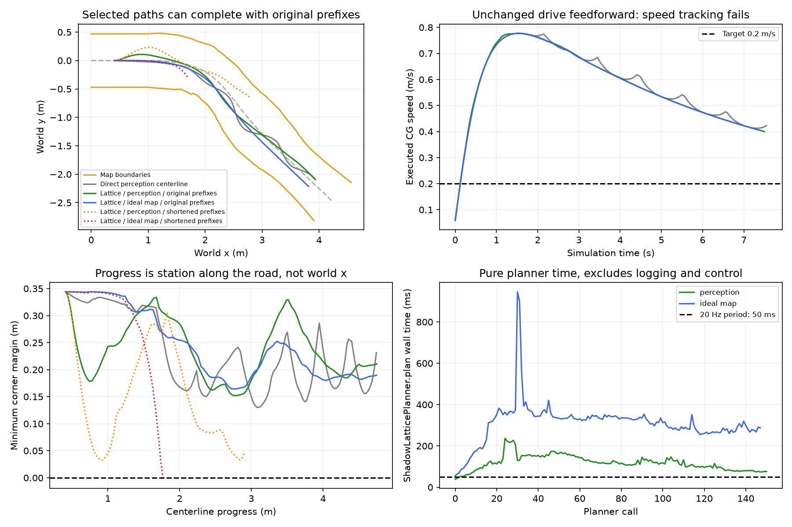

# 将 MVP2.1 lattice 选中路径用于控制

本文为初次对照的历史记录。后续已补齐1 Hz交付与路径缓存，当前默认模式和结果见
[1 Hz闭环实验](ONE_HZ_CONTROL.md)。本篇命令显式选择`control`以复现历史20 Hz重算。

保留 planner 原参数，并每个控制周期生成新路径时，本重建道路的感知输入和理想
道路输入均能完成闭环。**当前影子输出仍不能直接替换主控制参考**：原1 Hz输出
没有跨周期路径坐标更新；改为20 Hz同步计算又超过本机50 ms周期。速度跟踪也未通过。

上游固定为`f11428b5444ac4c714a95e86e71662086b3187bd`。本次仅修改离线实验入口，
不改上游源副本、YAML、部署入口、原policy、评分模型、C*和车辆模型；74个原文件
的原始字节与检查点一致。保留现有MVP控制器和执行器符号转换作为共同对照。

## 实验接线

沿用原RoadCenterlinePlanner的输入准入、当前帧时间戳、0.2 s参考有效期和0.2 m/s
目标速度，只将`path`替换为ShadowLatticePlanner的选中候选。候选的`(x,y,heading)`
直接取前两维，包装为有序折线；不重新拟合。仅`VALID`允许执行，`ALL_COLLIDE`
即使包含诊断选中项也停止，不回退中线。

本篇`--path-source lattice --lattice-cadence control`每个20 Hz控制周期重新规划，但**保留planner内部
`rate_hz=1`**及其他原参数，使碰撞/评分范围不变。这是同步暂停仿真的路径闭环
实验，尚未实现生产异步接入；`planning`日志字段仍是原中线准入诊断，选路信息
位于`reference.offline_path_experiment`和`shadow.jsonl`。

## 结果

进度均为沿道路中心线的弧长，非世界x坐标；目标进度4.736800 m。

| 路径与输入 | 执行周期 | 最终进度 | 最小车角道路余量 | 结果 |
|---|---:|---:|---:|---|
| 直接感知中线，对照 | 152 | 4.742971 m | 0.130085 m | 完成 |
| lattice，感知输入，原参数 | 151 | 4.749140 m | 0.151968 m | 完成，151次规划均VALID |
| lattice，理想道路，原参数 | 148 | 4.747009 m | 0.164213 m | 完成，148次规划均VALID |

对照的完整152帧动作与此前提交的运行结果逐项相同。这里只确认到达既定目标且
没有模块/车角拒绝；四角检查不是连续完整车身扫掠证明，没有测试末端停车。
三组最高执行速度均约0.777 m/s，目标0.2 m/s，原实车驱动前馈与课程plant仍不匹配。

### 直接替换的两个接入问题

1. **按原1 Hz直接交付路径**：只执行首个周期，下一周期出现
   `control_frame_or_time_mismatch`。路径属于上一周期的base_link坐标，当前状态
   时间戳已前进50 ms。仅重写时间戳会把旧车体坐标冒充当前坐标，需要真实运动
   对齐及有界缓存/失效处理；本实验没有绕过检查或延长有效期。
2. **同步提高到20 Hz计算**：保留原参数的两组纯`ShadowLatticePlanner.plan()`
   墙钟耗时分别平均118.637/310.192 ms，最大236.822/945.514 ms；
   148/151和148/148次超过50 ms。这里不含日志序列化或控制器，且两组顺序运行。
   当前离线仿真等待计算完成再推进50 ms，所以几何闭环通过不等于20 Hz实时通过。
   这些是当前Windows环境的实测，不能代替车载平台性能结论。

### 不能把调度频率直接写入现有 rate_hz

源码使用`hold = 1/rate_hz + handoff_allowance_s`，再计算
`check_length = speed * hold`、`score_length = max(0.2, check_length)`。
默认handoff为0.1 s。将该参数从1改到20，会把hold从1.1 s缩到0.15 s，
同时改变碰撞和评分范围，控制器仍读0.35 m预瞄处的路径方向。

单独做此参数敏感性对照，保持每周期重新规划和其余条件相同：

| 缩短范围后的输入 | 失败进度 | 失败 |
|---|---:|---|
| 感知输入 | 2.896132 m | 第83次规划ALL_COLLIDE，停止 |
| 理想道路 | 1.772598 m | 第44步车角越界约2.43 mm；该次规划仍为VALID |

理想道路末次检查范围约0.114 m、评分范围0.2 m，均短于0.35 m控制预瞄。
这说明调度频率与这些范围耦合会改变闭环结果，尚未隔离碰撞范围、评分范围各自的
贡献。不能据此认定原参数的planner选路本身无法通过该道路。
两组敏感性实验并行运行，其耗时不用于上面的性能结论。

下一步接入边界应先分开调度频率与碰撞/评分前瞻，再明确异步路径的坐标更新、
新旧结果选择、过期停止和控制周期预算；本次没有修改生产算法来实现这些行为。

## 复现

在仓库根目录使用既有解释器，输出目录必须不存在：

```powershell
# 原参数、每个控制周期重新规划；感知/理想道路各一组
../Baby-Bus/.verification/planner-sim-venv/Scripts/python.exe -B -m offline.mvp21_sim --path-source lattice --lattice-cadence control --output .verification/lattice-perception-new
../Baby-Bus/.verification/planner-sim-venv/Scripts/python.exe -B -m offline.mvp21_sim --path-source lattice --lattice-cadence control --road-input map --output .verification/lattice-map-new
# 原1 Hz直接交付，不做运动对齐，预期控制拒绝
../Baby-Bus/.verification/planner-sim-venv/Scripts/python.exe -B -m offline.mvp21_sim --path-source lattice --lattice-cadence upstream --output .verification/lattice-literal-1hz-new
# 显式缩短前瞻范围的敏感性对照；不是默认参数
../Baby-Bus/.verification/planner-sim-venv/Scripts/python.exe -B -m offline.mvp21_sim --path-source lattice --lattice-cadence control --lattice-prefix-rate-hz 20 --output .verification/lattice-short-prefix-new
../Baby-Bus/.verification/planner-sim-venv/Scripts/python.exe -B tests/test_mvp21_sim.py -v
```

本次8项适配检查通过，包括原中线旁路隔离、几何原样交付、诊断候选拒绝、时间戳
检查、两个连续规划周期和原1 Hz交付拒绝。上游源副本未改；此前210项纯模块结果
仍独立保留，本轮未重跑。ROS fast gate仍缺固定dream_interfaces checkout。

完整数据位于`.verification/mvp21-planner-control-20261015/`。其中`*-20hz-original-prefix`
为原参数主实验，较早的`perception-20hz`/`map-20hz`为内部rate改20的敏感性实验。
精简证据与原始文件SHA256见[planner-control.json](artifacts/2026-10-15/planner-control.json)。


