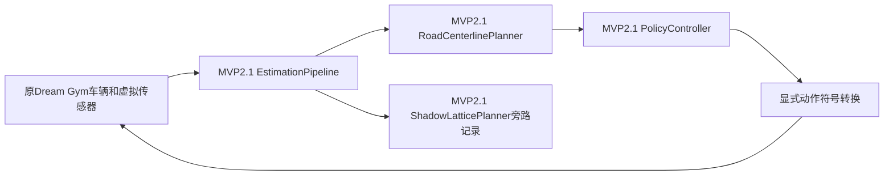
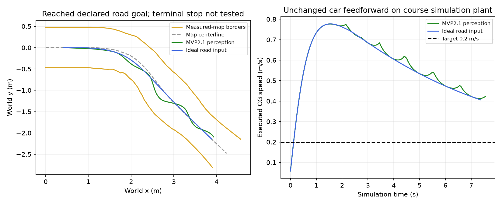

# MVP2.1 模块与原仿真框架的独立接入

当前状态先保存为`feature/native-road-checkpoint-20261015`，提交`d6d1b5c`。
本接入位于`feature/mvp21-sim-integration-20261015`，从该快照继续，保留原虚拟环境、
重建道路与训练框架。没有整分支合并或覆盖policy子模块。

上游固定为`mvp2.1`的`f11428b5444ac4c714a95e86e71662086b3187bd`。
`upstream/scripts/policy_node.py`和`upstream/config/ai4r_policy.yaml`是该提交的原样副本，
加载时检查Git源文件SHA256。它们是离线来源快照，不替换部署入口或当前配置。

## 保留范围与接线

`preserved-files.json`固定74个原有文件：`scripts/`、`config/`、
`offline/planner_sim/`、`offline/lattice_training/`，包括policy训练/评分实现、
特征编码、扩充前后模型与证据。每次实验前后核对文件指纹，本次还核对了原始字节
未改变。已有训练数据与完整日志继续留在`.verification/`，未重算或覆盖。

`source.py`通过正常Python导入加载[mvp21_policy](../../mvp21_policy/README.md)中的
实际算法，不导入ROS、不实例化`PolicyNode`，不执行`calculate_policy_actions()`。
上游单文件和YAML保留为来源快照，并额外记录实际模块源码指纹。接线为：



这版主控制是20 Hz有序中线/PID；影子lattice按原配置1 Hz抽查，只记录结果，
不参与选路或控制。任务提交与forward_geometry选择使用上游实际`_shadow_offer`
方法；计算在离线进程中同步完成，没有模拟ROS异步队列/发布延迟。
旧Frenet lattice、C*训练管线与学习policy均保留，本实验不调用其评分模型或C*控制。

`MVP21SimulationEnv`继承原环境，只在首次观测前选择新估计器，reset/fork/restore
继续使用原框架。车辆动力学、RK4、原notebook配置、42个重建锥桶及10 Hz相机/
0.20 s观测延迟沿用快照。感知输入默认来自虚拟传感器；`--road-input map`将道路
替换为原2 m理想地图输入，速度/偏航仍使用新估计器的测量输出。
沿用原重建回放的初始化：首个规划周期前以零动作运行延迟步数+2，默认6步/
0.30 s，用于填充传感器与运动历史。零速时起始位置保持；这未覆盖ROS启动状态机。

实车参数规定正转向请求向右，课程plant正前轮角向左。适配层显式使用
`plant_steer=-upstream_steer`，保持原增益、限幅、驱动请求和前馈不变。
`--steering-sign`可显式选择另一种执行器符号；没有暗中调参或重标定车辆。

## 运行

在`Baby-Bus-lattice-training`根目录，继续使用现有解释器。唯一补装依赖为
PyYAML6.0.2，用于读取原YAML；没有升级Dream Gym、NumPy等原依赖。
另一台机器的完整依赖见`requirements.txt`。默认使用快照中可移植的重建道路fixture。

```powershell
../Baby-Bus/.verification/planner-sim-venv/Scripts/python.exe -B -m offline.mvp21_sim --output .verification/mvp21-new-perception
../Baby-Bus/.verification/planner-sim-venv/Scripts/python.exe -B -m offline.mvp21_sim --road-input map --output .verification/mvp21-new-map
```

输出目录必须尚不存在，以保留历史证据。`trace.jsonl`包含每个50 ms周期的实际
参考、控制诊断、动作、决策坐标原点、执行位置/速度和plant车角边界距离；
`shadow.jsonl`单独记录影子候选；`summary.json`记录来源、参数、结果及限制。
`--no-shadow`可检查旁路隔离。还支持`--road`、`--seed`、`--progress`、
`--initial-speed`、`--latency-steps`、`--max-steps`。

命令退出0仅表示到达既定道路目标且未遇到模块/执行拒绝；速度跟踪、末端停车、
连续车身扫掠、ROS协议和车载实时性各自需要验证，不能由这个退出码推断通过。
这里没有改变`use_sim_time`、启动ROS、Enable、Run或发布硬件动作。

## 本次结果

| 输入 | 有效参考 | 最后中心线进度 | 目标进度 | 模块/执行拒绝 |
|---|---:|---:|---:|---|
| 新感知输出 | 152 | 4.742971 m | 4.736800 m | 无 |
| 理想地图输入 | 148 | 4.744388 m | 4.736800 m | 无 |
| 新感知、关闭影子 | 152 | 4.742971 m | 4.736800 m | 无 |

两组开启影子的实验各运行8次影子规划，均为VALID。开启/关闭影子的完整152帧
动作序列逐项相同。VALID仅按上游定义表示已知边界上的指定短段没有检测到碰撞，
不是影子控制通过；影子车身假设为0.30 m宽，与课程plant的0.25 m不同。

**速度跟踪没有通过。**保留实车0.30驱动前馈时，课程车辆最高速度分别为
0.776718/0.777113 m/s，目标为0.2 m/s；平均绝对速度误差约0.387/0.384 m/s。
实车需要的维持油门与当前理想力模型不同，没有为了得到漂亮结果改写控制参数。
plant四角到道路的最小诊断距离分别为0.130085/0.213147 m；这个指标不是连续
完整车身扫掠证明。目标前方仍保留原管线的车身/道路余长，未测试末端停车。



实际上游纯源测试：估计97、规划17、控制33、中心线41、影子22，合计210项通过。
本适配新增6项检查全部通过，覆盖来源/保留范围、估计器reset/fork/restore、
原forward_geometry任务提交、动作符号、重建道路与影子动作隔离，共216项。
上游测试在`.verification/mvp21-integration-20261015/upstream/`的原样源副本上运行，
没有用新版本测试覆盖当前`tests/`。ROS fast gate仍缺固定dream_interfaces checkout，
本轮未重跑；没有把纯模块测试计为ROS或实车验收。

```powershell
../Baby-Bus/.verification/planner-sim-venv/Scripts/python.exe -B tests/test_mvp21_sim.py -v
```

精简结果与指纹见[verification.json](artifacts/2026-10-15/verification.json)，
完整三组trace及测试日志在`.verification/mvp21-integration-20261015/`。

## 将 lattice 路径接给控制器

新增显式离线开关`--path-source lattice`，默认入口仍直接跟踪感知中线。
保留planner原参数、每控制周期重新生成选中路径时，感知/理想道路两组均跑完；
原1 Hz直接交付存在坐标时间不一致，20 Hz同步计算则超过当前机器的周期预算。
调度与碰撞/评分前瞻共用`rate_hz`的参数耦合也会导致不同闭环结果。
接线、全部对照与复现命令见[planner控制实验](PLANNER_CONTROL_EXPERIMENT.md)。
